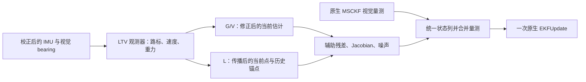

# LTV 融合 OpenVINS：当前实现的公式与数据流

本文对应当前源码中的 LTV 观测器、G/V/L 辅助量测及 OpenVINS 原生 EKF 更新。公式用于解释实际实现，不能作为统计一致性或精度提升的证明。尤其需要区分：**观测器设计矩阵、主滤波器协方差、辅助量测噪声是三个不同对象**。

## 1. 数据流与两套状态

观测器有自己的动态状态和设计矩阵；辅助模型只构造量测，不自行修改 OpenVINS 状态。主状态的实际增益、均值和协方差更新由 `StateHelper::EKFUpdate` 完成。

### 1.1 坐标、符号与单位

| 符号 | 定义 |
|---|---|
| $G$、$B_t$、$C$ | OpenVINS 世界系、时刻 $t$ 的 IMU 机体系、相机系 |
| $R_t=R_{G\to B_t}$ | 世界系向量变换到当前机体系；对应 IMU/clone 的 `Rot()` |
| $p_t=p_{B_t}^{G}$、$v_t=v_{B_t}^{G}$ | IMU 在世界系中的位置、速度，单位 m、m/s |
| $l_{i,t}^{B_t}$ | 静态路标 $i$ 相对当前 IMU 原点的位置，表示在当前机体系，单位 m |
| $v_{B_t}=R_t v_t$、$g_{B_t}=R_t g^G$ | 机体系速度和物理重力，单位 m/s、m/s² |
| $R_{BC}=R_{C\to B}$、$p_{BC}=p_C^B$ | 相机到 IMU 的旋转、相机原点在 IMU 系中的位置 |
| $[u]_\times$ | 叉乘矩阵，满足 $[u]_\times w=u\times w$ |
| $\gamma=(0,0,-1)^\top$、$g^G=g_0\gamma$ | 模型使用的世界系重力方向和重力向量，$g_0>0$ |
| $P_o$ | LTV 观测器设计矩阵，对应 `LtvObserver::covariance_` |
| $P$ | OpenVINS 完整误差状态协方差，对应 `State::_Cov` |
| $\mathcal R_j$ | 辅助量测 $j$ 使用的噪声矩阵；与旋转 $R_t$ 区分 |

文中的 $(\cdot)^\star$ 表示 Jacobian 的线性化值：启用 FEJ 时取 `fej()` / `Rot_fej()`，否则取当前值。上标 $-,+$ 分别表示一次更新前、后的值。

### 1.2 OpenVINS 误差状态和姿态扰动

概念上的主状态包括 IMU 姿态、位置、速度、偏置、clone 位姿，以及配置中启用的标定和 SLAM 路标。其误差状态可写为：

$$
\delta x=
\begin{bmatrix}
\delta\theta_t\\ \delta p_t\\ \delta v_t\\
\delta b_g\\ \delta b_a\\
\delta\theta_{a_1}\\ \delta p_{a_1}\\ \vdots\\
\delta x_{\mathrm{calib}}\\ \delta x_{\mathrm{SLAM}}
\end{bmatrix}\in\mathbb R^n.
$$

这是符号排列，实际列位置由各个 `Type` 的 `id()`、`size()` 决定，不能直接硬编码为上式的下标。位置、速度误差在世界系中采用加法；姿态采用 JPL 四元数左乘误差：

$$
q_{G\to B}^{\mathrm{true}}\simeq
\delta q(\delta\theta)\otimes_{\mathrm{JPL}}\hat q_{G\to B},
\qquad
R^{\mathrm{true}}\simeq (I-[\delta\theta]_\times)\hat R.
$$

因此，对于给定世界系向量 $u$：

$$
R^{\mathrm{true}}u\simeq \hat Ru+[\hat Ru]_\times\delta\theta.
$$

下文的 $H$ 是**预测函数对误差状态的 Jacobian**，约定为：

$$
z=h(x^{\mathrm{true}})+n_j,
\qquad
r=z-h(\hat x)\simeq H\delta x+n_j.
$$

这与把 $r(\hat x)=z-h(\hat x)$ 直接对估计变量求导的负号不同。辅助量测存在相关性近似，以上是代码所采用的线性量测形式，并非断言它的噪声真的与先验独立。

源码：[JPLQuat::update](../ov_core/src/types/JPLQuat.h)、[PoseJPL::update](../ov_core/src/types/PoseJPL.h)、[Vec::update](../ov_core/src/types/Vec.h)。

### 1.3 LTV 状态

保留 $N$ 个路标时，观测器状态为：

$$
x_o=
\begin{bmatrix}
l_1^B\\ \vdots\\ l_N^B\\ v_B\\ g_B
\end{bmatrix}\in\mathbb R^{n_o},\qquad n_o=3N+6.
$$

该状态不包含主滤波器的姿态、世界位置或 SLAM 地图状态。即使只融合 G 或 V，路标也参与观测器内部估计；L 模式控制的是是否额外生成路标辅助位姿量测。

源码：[LtvObserver](../ov_msckf/src/ltv/LtvObserver.h)、[LtvObserver 的数学实现](../ov_msckf/src/ltv/LtvObserver.cpp)。

## 2. LTV 观测器：传播与相机修正

### 2.1 IMU 输入与连续动态

记 $a_B$ 为已完成偏置和标定校正的加速度计比力，$\omega_B$ 为校正后的角速度。静态路标、机体系速度和重力满足：

$$
\begin{aligned}
\dot l_i^B&=-[\omega_B]_\times l_i^B-v_B,\\
\dot v_B&=-[\omega_B]_\times v_B+g_B+a_B,\\
\dot g_B&=-[\omega_B]_\times g_B.
\end{aligned}
$$

这里的 $g^G=(0,0,-g_0)^\top$ 是物理重力。原生 `Propagator::_gravity` 保存 $(0,0,+g_0)^\top$，并在世界系速度传播中将其减去，因此：

$$
g^G=-\texttt{\_gravity},\qquad
\dot v^G=R_t^\top a_B+g^G.
$$

将此式变换到随 IMU 旋转的机体系，就得到上面的 $\dot v_B$；$a_B$ 是比力，不能再从中重复扣除重力。

令 $\Omega=-[\omega_B]_\times$，则 $\dot x_o=A x_o+b$：

$$
A=
\begin{bmatrix}
I_N\otimes\Omega&-\mathbf 1_N\otimes I_3&0_{3N\times3}\\
0_{3\times3N}&\Omega&I_3\\
0_{3\times3N}&0_{3\times3}&\Omega
\end{bmatrix},
\qquad
b=\begin{bmatrix}0_{3N}\\a_B\\0_3\end{bmatrix}.
$$

其中 $\otimes$ 是 Kronecker 积，$\mathbf 1_N$ 是 $N$ 维全一列向量。三个分组依次为 $3N$ 维路标、3 维速度和 3 维重力；$N=0$ 时只保留速度、重力部分。实现按相邻 IMU 样本分段传播，每段使用校正后两端样本的算术均值：

$$
\bar a_k=\tfrac12(a_k+a_{k+1}),\qquad
\bar\omega_k=\tfrac12(\omega_k+\omega_{k+1}).
$$

使用宿主传播前保存的偏置；校正调用复用 `Propagator::correct_imu`。相机时刻通过 $t_I=t_C+\delta t_{C\to I}$ 映射到 IMU 时间，所需 IMU 区间来自宿主缓存。

源码：[VioManager::process_ltv](../ov_msckf/src/core/VioManagerLTV.cpp)、[Propagator](../ov_msckf/src/state/Propagator.cpp)。

### 2.2 当前离散实现和设计矩阵

对一个正时间间隔 $\Delta t$，代码使用一阶离散化：

$$
F_o=I_{n_o}+\Delta t A,
\qquad
x_o^-=F_o x_o^++\Delta t b.
$$

设计过程项为：

$$
V_o=\operatorname{diag}
\left(\nu_l I_{3N},\nu_v I_3,\nu_g I_3\right),
$$

其中 $\nu_l,\nu_v,\nu_g$ 对应 `v_landmark`、`v_velocity`、`v_gravity`。设计矩阵传播：

$$
P_o^-=F_oP_o^+F_o^\top+\Delta t V_o,
\qquad
P_o^-\leftarrow\tfrac12\left(P_o^-+(P_o^-)^\top\right).
$$

在精确算术下，$P_o^+\succeq0,V_o\succeq0$ 可保证传播结果半正定；这不保证一阶离散模型在任意步长下都准确或长期稳定。实现保留时间、有限性和维度检查，不进行重复谱裁剪。

### 2.3 Bearing 的线性投影量测

当前观测器修正只使用相机 0 的 bearing；其他相机可参与种子几何初始化。由归一化图像坐标构造 $b_i^C=(x_{n,i},y_{n,i},1)^\top$，它通常不是单位向量。先归一化长度并变换到 IMU 系：

$$
u_i^B=R_{BC}\frac{b_i^C}{\|b_i^C\|},\qquad
\Pi_i=I_3-u_i^Bu_i^{B\top}.
$$

路标与相机原点的连线应平行于视线，因此：

$$
\Pi_i(l_i^B-p_{BC})=0.
$$

实现写成 $y_o=C_o x_o$。每个有效观测提供一个三维块：

$$
(C_o)_i=\begin{bmatrix}0&\cdots&\Pi_i&\cdots&0\end{bmatrix},
\qquad
(y_o)_i=\Pi_i p_{BC},
\qquad
r_o=y_o-C_o x_o^-.
$$

有 $M$ 个观测时，$C_o\in\mathbb R^{3M\times n_o}$。每个 $\Pi_i$ 的秩为 2，但代码保留三行投影约束；不能把它等同于三个独立物理方向的信息。

### 2.4 相机修正与 Joseph 形式

令 $q_l>0$ 对应 `q_landmark`，相机事件间隔为 $\Delta t_c$。当 $M>0$ 且 $\Delta t_c>0$ 时：

$$
\mathcal R_o=\frac{1}{q_l\Delta t_c}I_{3M},\qquad
S_o=C_oP_o^-C_o^\top+\mathcal R_o,
$$

$$
K_o=P_o^-C_o^\top S_o^{-1},\qquad
x_o^+=x_o^-+K_o r_o.
$$

代码使用 LLT 线性求解得到 $K_o$，不显式计算 $S_o^{-1}$。令 $J_o=I-K_oC_o$，设计矩阵采用 Joseph 更新：

$$
P_o^+=J_oP_o^-J_o^\top+K_o\mathcal R_oK_o^\top,
\qquad
P_o^+\leftarrow\tfrac12\left(P_o^++(P_o^+)^\top\right).
$$

首次相机事件由宿主传入 $\Delta t_c=0$，跳过均值与设计矩阵修正；无观测 $M=0$ 时也跳过。观测数和修正前创新范数仍更新。LLT 或有限性检查失败时返回失败，由宿主处理暂停、恢复或重置。

**$P_o$、$V_o$、$\mathcal R_o$ 是当前观测器的设计对象。它们不直接给出 G/V/L 辅助量测的统计噪声，也不作为主 EKF 的 $P$ 或 $\mathcal R$。**

源码：`LtvObserver::propagateImu`、`correct`，见 [LtvObserver.cpp](../ov_msckf/src/ltv/LtvObserver.cpp)。

### 2.5 路标初始化、增删和交叉块

重置时没有路标，

$$
x_o=0_6,\qquad P_o=\operatorname{diag}(p_{v,0}I_3,p_{g,0}I_3).
$$

因此重置后的重力零向量不是有效物理估计，需要通过预热、健康和就绪检查后才能融合。

路标种子来自特征模块的几何初始化。若新路标的 `apply_mean` 为真，则设置 $l_i^B=l_{i,\mathrm{seed}}^B$，否则均值保持零。新路标设计块设为 $p_{l,0}I_3$，与保留状态的初始交叉块置零。既有路标不在同一 epoch 内重新播种。

设 $D$ 表示保留和重排旧状态的索引映射，则保留部分相当于：

$$
x_{o,\mathrm{retained}}^{\mathrm{new}}=D x_o^{\mathrm{old}},\qquad
P_{o,\mathrm{retained}}^{\mathrm{new}}=D P_o^{\mathrm{old}}D^\top.
$$

保留路标之间、路标与速度/重力之间的交叉块全部保留。退役路标的行列删除；这里是动态状态布局调整，不是主滤波器的路标量测更新。

源码：[LtvObserver::synchronize / rebuildState](../ov_msckf/src/ltv/LtvObserver.cpp)、[LtvFeatureManager](../ov_msckf/src/ltv/features/LtvFeatureManager.cpp)。

### 2.6 种子几何与局部风险

种子可由同一时刻的双目观测、相机 0 的时序观测，或先尝试双目再回退到时序的策略生成。每次估计使用同一个当前主状态上下文中的位姿；已边缘化的 clone 不用旧位姿均值代替。

以下 $k$ 索引同一特征的相机观测，其位姿时刻为 $t_k$、相机系为 $C_k$。令单位 bearing 为 $\beta_k^{C_k}$，对应相机中心和世界系单位视线为：

$$
c_k^G=p_{t_k}+R_{t_k}^\top p_{BC_k},\qquad
d_k^G=R_{t_k}^\top R_{BC_k}\beta_k^{C_k},\qquad
\Pi_k^G=I_3-d_k^Gd_k^{G\top}.
$$

这里 $p_{BC_k},R_{BC_k}$ 是该相机的外参。最小化各视线的垂直距离平方，得到：

$$
\hat p_F^G=\arg\min_p\sum_k\|\Pi_k^G(p-c_k^G)\|^2,
\qquad
W_s=\sum_k\Pi_k^G,\qquad b_s=\sum_k\Pi_k^G c_k^G,
$$

$$
W_s\hat p_F^G=b_s,\qquad
l_{\mathrm{seed}}^{B_t}=R_t(\hat p_F^G-p_t).
$$

实现至少需要两个观测，并要求 $\lambda_{\min}(W_s)>10^{-12}\lambda_{\max}(W_s)$，通过后用 LDLT 求解。正视线距离、视差、条件数及角残差等进一步准入检查由几何估计和特征管理模块完成。

令 $\xi_s$ 按“各唯一位姿的旋转/平移、各相机外参的旋转/平移、各观测的二维 bearing 切平面误差”排列，$J_s=\partial l_{\mathrm{seed}}^{B_t}/\partial\xi_s$。几何模块对 $R_{B\to G}=R_t^\top$ 使用右乘正旋转扰动，与第 1.2 节的 JPL 姿态误差一致；平移误差仍在世界系中。局部不确定性传播为：

$$
\Sigma_s=J_s\Sigma_{\xi_s}J_s^\top.
$$

当前宿主保留所用主位姿之间的全部协方差交叉块；固定外参的行列置零，各 bearing 使用 $\sigma_b^2I_2$，其与位姿及其他 bearing 的交叉块置零。$\sigma_b$ 对应 `feature_bearing_sigma_rad`。

设种子的锚定观测为 $k_a$，其视线在当前机体系中的表示为 $d_{s,a}^{B_t}=R_t d_{k_a}^G$，种子到该相机中心的距离为 $r_s=\|\hat p_F^G-c_{k_a}^G\|$，则：

$$
\sigma_{s,\parallel}=\sqrt{\max(0,d_{s,a}^{B_t\top}\Sigma_s d_{s,a}^{B_t})},\qquad
\mathrm{risk}_s=\frac{\sigma_{s,\parallel}}{r_s}.
$$

该无量纲风险用于种子准入，不是经统计校准的置信区间；$r_s$ 是欧氏距离，不是光轴深度。**$\Sigma_s$ 不直接写入 $P_o$：新路标的设计块仍按第 2.5 节设为 $p_{l,0}I_3$，交叉块初始化为零。** 种子锚定观测与第 5 节 L 辅助量测的历史锚点是两个不同概念。

源码：[LtvSeedEstimator / LtvSeedUncertainty](../ov_msckf/src/ltv/features/LtvSeedGeometry.cpp)、[种子输入与准入](../ov_msckf/src/ltv/features/LtvFeatureManager.cpp)。

## 3. G：二维重力方向辅助量测

G 使用当前相机修正后的观测器输出 $\hat g_B$。先归一化：

$$
u_G=\frac{\hat g_B}{\|\hat g_B\|},\qquad
h_G=R_t\gamma.
$$

为避免将重力方向写成三个独立约束，模型在二维切平面中构造残差。令：

$$
d^\star=R_t^\star\gamma.
$$

从三个坐标轴中选出与 $d^\star$ 最不平行的一条 $a=e_j$，其中 $j=\arg\min_j|d_j^\star|$，构造：

$$
t_1=\frac{a-d^\star(d^{\star\top}a)}{\|a-d^\star(d^{\star\top}a)\|},
\qquad t_2=d^\star\times t_1,
\qquad T=\begin{bmatrix}t_1&t_2\end{bmatrix}.
$$

满足 $T^\top T=I_2,T^\top d^\star=0$。残差是：

$$
r_G=T^\top(u_G-R_t\gamma)\in\mathbb R^2.
$$

局部列顺序为 $[\delta\theta_t,\delta v_t]$：

$$
H_G=\begin{bmatrix}
T^\top[R_t^\star\gamma]_\times&0_{2\times3}
\end{bmatrix}\in\mathbb R^{2\times6}.
$$

实现把姿态和速度两个 `Type` 都列入 `order`，但速度块为零。直接约束重力方向对应的姿态自由度，不提供独立的世界航向或位置观测；其他主状态仍可能通过交叉协方差变化。线性化时 $T$ 固定，不对切平面基重新求导。

若 G 权重为 $w_G>0$：

$$
\sigma_G=\frac{10\pi/180}{\sqrt{w_G}},\qquad
\mathcal R_G=\sigma_G^2I_2.
$$

残差是单位方向投影，数值上无量纲；噪声采用角度转弧度后的平方作为方向误差尺度近似，不是严格的球面角距离模型。

源码：[UpdaterLTV::context / gravity](../ov_msckf/src/update/UpdaterLTV.cpp)、[权重换算](../ov_msckf/src/ltv/LtvOptions.cpp)。

## 4. V：机体系速度辅助量测

V 使用当前相机修正后的观测器速度 $\hat v_B$，预测值和残差为：

$$
h_V=R_t v_t,\qquad
r_V=\hat v_B-R_t v_t\in\mathbb R^3.
$$

由姿态左扰动和世界系速度加法误差：

$$
h_V(x+\delta x)\simeq
R_t v_t+[R_t v_t]_\times\delta\theta_t+R_t\delta v_t.
$$

局部列顺序同 G，FEJ Jacobian 为：

$$
H_V=\begin{bmatrix}
[R_t^\star v_t^\star]_\times&R_t^\star
\end{bmatrix}\in\mathbb R^{3\times6}.
$$

若 V 权重为 $w_V>0$：

$$
\sigma_V=\frac{1\ \mathrm{m/s}}{\sqrt{w_V}},\qquad
\mathcal R_V=\sigma_V^2I_3.
$$

残差取当前 $R_t,v_t$，Jacobian 取 FEJ 或当前值。观测器设计矩阵中的速度块没有被直接作为 $\mathcal R_V$。

源码：[UpdaterLTV::velocity](../ov_msckf/src/update/UpdaterLTV.cpp)。

## 5. L：路标估计生成的相对位姿辅助量测

### 5.1 当前点与历史锚点的时机

对同一个物理特征，保留两个值：

- $\hat l_{i,t}^{B_t,-}$：IMU 传播后、当前相机修正前，观测器中的路标值。
- $\hat l_{i,a}^{B_a,+}$：过去相机修正后保存的路标值，锚点时刻 $a<t$。

当前候选由 `LtvLandmarkHistory::before` 选出；历史值由 `after` 保存。候选使用 epoch、特征 ID、内部 ID 和准入时刻区分生命周期，并要求锚点对应的 clone 仍然存在。**G/V 取当前修正后输出，L 当前候选取修正前值，三者的数据时机不完全相同。**

特征种子初始化与该辅助量测是不同环节：L 残差不负责设置初始特征输入，也不把观测器路标直接写入主状态的 SLAM 路标。

源码：[LtvLandmarkHistory::before / after](../ov_msckf/src/ltv/features/LtvLandmarkHistory.cpp)、[候选字段](../ov_msckf/src/ltv/features/LtvLandmarkHistory.h)。

### 5.2 预测和残差

由过去锚点估计构造一个世界系位置：

$$
\hat p_{F_i}^{G}(x)=R_a^\top\hat l_{i,a}^{B_a,+}+p_a.
$$

再预测该点在当前机体系中的位置：

$$
h_{L_i}(x)=R_t\left(R_a^\top\hat l_{i,a}^{B_a,+}+p_a-p_t\right).
$$

于是：

$$
r_{L_i}=\hat l_{i,t}^{B_t,-}-h_{L_i}(\hat x)\in\mathbb R^3.
$$

这里的世界点由历史 LTV 点和主状态锚点共同构造，不是一个独立、无误差的外部地图点。

### 5.3 位姿 Jacobian

局部列顺序是：

$$
\delta x_{L_i}=
\begin{bmatrix}\delta\theta_t\\\delta p_t\\\delta\theta_a\\\delta p_a\end{bmatrix}
\in\mathbb R^{12}.
$$

代码中的 `order` 为当前 IMU 的 `q()`、`p()` 和完整过去 `PoseJPL` clone。线性化时路标值被当作给定量，只对位姿求导：

$$
H_{L_i}=\begin{bmatrix}
[h_{L_i}^\star]_\times&-R_t^\star&
-R_t^\star R_a^{\star\top}[\hat l_{i,a}^{B_a,+}]_\times&R_t^\star
\end{bmatrix}\in\mathbb R^{3\times12},
$$

其中：

$$
h_{L_i}^\star=R_t^\star\left(R_a^{\star\top}\hat l_{i,a}^{B_a,+}+p_a^\star-p_t^\star\right).
$$

四个块分别来自：当前旋转改变点的表示、当前平移改变相对位置、锚点旋转改变世界点位置、锚点平移改变世界点位置。锚点姿态块的负号来自：

$$
\delta(R_a^\top l_a)
=R_a^\top[\delta\theta_a]_\times l_a
=-R_a^\top[l_a]_\times\delta\theta_a.
$$

残差使用当前位姿预测，Jacobian 使用 FEJ 位姿或当前位姿；不冻结残差，也不重新给历史路标值建立 FEJ 状态。直接约束的是两个位姿，通过主协方差的交叉块还可能改变速度、偏置等状态。

源码：[UpdaterLTV::landmark_prediction / landmark_jacobian / landmark](../ov_msckf/src/update/UpdaterLTV.cpp)。

### 5.4 L 噪声与信息上限

设时间跨度 $\tau_i=t-a$，每事件最多选取 $N_{L,\max}$ 个点，权重为 $w_L>0$。基础尺度和信息上限为：

$$
\sigma_{L,0}=\frac{0.5\ \mathrm m}{\sqrt{w_L}},\qquad
c_L=0.01w_L,\qquad c_i=\frac{c_L}{N_{L,\max}}.
$$

距离和时间跨度决定基础方差：

$$
\sigma_i=\sigma_{L,0}+0.02\|\hat l_{i,t}^{B_t,-}\|,
\qquad
\rho_{i,\mathrm{base}}=\sigma_i^2\left(1+\frac{\tau_i}{0.55\ \mathrm s}\right).
$$

令 $P_{L_i}$ 是从**主滤波器 $P$** 提取的上述 12 维边缘协方差，包含当前和锚点之间的全部交叉块：

$$
s_i=\operatorname{tr}(H_{L_i}P_{L_i}H_{L_i}^\top),
\qquad
\rho_i=\max\left(\rho_{i,\mathrm{base}},\frac{s_i}{c_i}\right),
\qquad
\mathcal R_{L_i}=\rho_i I_3.
$$

它限制的是当前代码中的归一化预测方差指标：

$$
\operatorname{tr}\left(\mathcal R_{L_i}^{-1}H_{L_i}P_{L_i}H_{L_i}^\top\right)\le c_i.
$$

这里 $\rho_i$ 的单位为 m²，$s_i/c_i$ 与其同量纲。该上限是融合强度的启发式约束，不是对真实增量信息、互信息或一致性的证明。上限按配置的最大点数分配，不按当前实际通过的点数重新分配。

### 5.5 L 候选筛选

当前历史候选要求成熟、速度分支就绪标志 `ready_V` 为真，即使 V 模式没有直接融合。这里使用调用 `prepare` 时的 `life.status.ready_V`，尚未由本次相机修正更新；成熟度也按调用 `before` 时保留的 `management.time` 与准入时刻之差计算。

G/V 融合使用本次修正后更新的 `frame.ready_G` / `frame.ready_V`；L 模型不再检查当前 `frame.ready_V`，但仍要求当前 `frame.valid`。因此，不能用当前日志中的 `ready_V` 单独解释 L 候选是否通过历史筛选。

还要求时间跨度满足以下区间；实现允许边界误差 $\epsilon_\tau=10^{-6}\ \mathrm s$：

$$
0.2\ \mathrm s-\epsilon_\tau\le\tau_i\le0.55\ \mathrm s+\epsilon_\tau.
$$

先按当前主位姿预测 $l_{i,\mathrm{main}}$，检查：

$$
\frac{\|\hat l_{i,t}^{B_t,-}-l_{i,\mathrm{main}}\|}
{\max(\|l_{i,\mathrm{main}}\|,0.1\ \mathrm m)}\le0.02.
$$

这里 $l_{i,\mathrm{main}}$ 是第 5.2 节用当前主位姿计算的 $h_{L_i}(\hat x)$。把当前 LTV 点和该主位姿预测点变换到当前相机 0 系：

$$
q_{i,\mathrm{ltv}}^C=R_{BC}^\top(\hat l_{i,t}^{B_t,-}-p_{BC}),\qquad
q_{i,\mathrm{main}}^C=R_{BC}^\top(l_{i,\mathrm{main}}-p_{BC}).
$$

两个向量均需有限、模长至少 $0.1\ \mathrm m$ 且光轴深度 $(q^C)_z>0$，同时要求特征关联有效。

每个特征使用最早仍有对应 clone 且早于当前时刻的历史锚点；找到后只检查这一个锚点。即使它未通过跨度或残差等门控，也不会继续尝试更晚的锚点。候选按特征 ID 排序，再由量测模型限制最多选取的点数，默认 $N_{L,\max}=2$。L 的候选筛选是基于在线估计的门控，没有使用 GT。

源码：[历史候选筛选](../ov_msckf/src/ltv/features/LtvLandmarkHistory.cpp)、[准备与就绪状态更新顺序](../ov_msckf/src/core/VioManagerLTV.cpp)、[L 量测构造](../ov_msckf/src/update/UpdaterLTV.cpp)。

## 6. MSCKF 视觉量测与联合列映射

### 6.1 原生视觉块

对一个路标的多帧重投影量测，原生模型写为：

$$
r_f\simeq H_{x,f}\delta x_f+H_f\delta p_F+n_f.
$$

取路标 Jacobian 的左零空间正交基 $N_f$，满足 $N_f^\top H_f=0$、$N_f^\top N_f=I$：

$$
r_f'=N_f^\top r_f,\qquad H_f'=N_f^\top H_{x,f}.
$$

这样消去该路标的误差变量，不将它加入主 EKF 状态。代码用 Givens 旋转构造投影，并截去 $H_f$ 列数对应的行，没有显式估计数值秩；在满列秩时，保留行数为原始残差行数减去 $\operatorname{cols}(H_f)$。若退化导致秩下降，该实现不会自动保留完整左零空间的所有行。

视觉噪声为各向同性像素噪声，因 $N_f^\top(\sigma_{\mathrm{pix}}^2I)N_f=\sigma_{\mathrm{pix}}^2I$，正交投影后的有效行仍采用相同尺度。通过原生逐特征卡方检查的量测被堆叠，随后进行正交量测压缩，得到：

$$
r_{\mathrm{vis}},\quad H_{\mathrm{vis}},\quad
\mathcal R_{\mathrm{vis}}=\sigma_{\mathrm{pix}}^2I.
$$

逐特征卡方阈值为 `chi2_multipler` 乘相应残差自由度的 95% 卡方分位数；它与 G/V 辅助门控的阈值不是同一组参数。

源码：[UpdaterMSCKF::update](../ov_msckf/src/update/UpdaterMSCKF.cpp)、[UpdaterHelper 的重投影、零空间和压缩](../ov_msckf/src/update/UpdaterHelper.cpp)。

### 6.2 列不是简单拼接

各量测有自己的 `order`。G/V 使用当前姿态、速度，L 使用当前姿态、位置和锚点，视觉量测通常涉及 clone 和标定参数。共享变量必须映射到同一列，不能把各块的局部列直接横向拼接。

设 $\delta x_J=E_J\delta x$ 是量测涉及的主状态变量并集；每块有局部映射 $D_j$，满足 $\delta x_j=D_j\delta x_J$。联合量测为：

$$
r=\begin{bmatrix}r_{\mathrm{vis}}\\r_G\\r_V\\r_{L_1}\\\vdots\end{bmatrix},
\qquad
H=\begin{bmatrix}
H_{\mathrm{vis}}D_{\mathrm{vis}}\\
H_GD_G\\H_VD_V\\H_{L_1}D_{L_1}\\\vdots
\end{bmatrix},
$$

$$
\mathcal R=\operatorname{blockdiag}
\left(\mathcal R_{\mathrm{vis}},\mathcal R_G,\mathcal R_V,
\mathcal R_{L_1},\ldots\right).
$$

未启用或被拒绝的分支没有对应行。所有辅助行都通过时，行数为 $m_{\mathrm{vis}}+2+3+3N_L$；默认最多两个 L 点时，辅助块最多 11 行。合并不会删除视觉块或 L 块内部已有的噪声结构，但会把**不同来源块之间的噪声交叉块设为零**。

代码按相同 `Type` 指针、ID 和尺寸复用列，拒绝不一致的重叠范围，检查变量属于当前 State。主状态协方差 $P$ 本身没有被改成块对角矩阵。

源码：[merge_measurements / validate_measurement](../ov_msckf/src/update/UpdaterHelper.cpp)、[MeasurementBlock](../ov_msckf/src/update/UpdaterHelper.h)。

## 7. 原生 EKF：创新、增益、协方差和均值更新

联合量测在同一个原生先验上构造。量测变量的边缘协方差为：

$$
P_J=E_JP^-E_J^\top.
$$

创新协方差、全状态交叉项和增益为：

$$
S=HP_JH^\top+\mathcal R,\qquad
M=P^-E_J^\top H^\top,\qquad
K=MS^{-1}\in\mathbb R^{n\times m}.
$$

**$H$ 只包含量测相关列，但 $K$ 包含完整主状态的行。** 原生代码对每个主状态变量，从其与所有量测变量的交叉协方差累加 $M_i$：

$$
M_i=\sum_{j\in J}P_{ij}H_j^\top.
$$

因此，即使某个状态没有直接量测列，只要有相关的交叉协方差，也可能获得非零修正。这解释了 L 直接约束位姿，但仍可能间接修正速度和偏置。

实现只构造 $S$ 的上三角，按自伴矩阵解释，通过 LLT 解单位阵得到 $S^{-1}$，再计算 $K$。与观测器求解方式不同，但仍不是通用矩阵求逆调用。

### 7.1 主协方差更新

原生代码使用：

$$
P^+=P^- - KM^\top,
$$

在精确算术和对称创新协方差下，等价于：

$$
P^+=P^- - KSK^\top.
$$

实际只写上三角，再由上三角恢复对称矩阵。**主 EKF 当前没有使用本文第 2 节的 Joseph 形式，也没有在该函数中额外应用姿态误差重置 Jacobian。** 更新后检查协方差对角线是否出现负值；这不等价于完整的半正定谱检查。

### 7.2 主状态误差注入

先计算：

$$
\delta\hat x=Kr.
$$

位置、速度、偏置等向量状态采用：

$$
\hat p^+=\hat p^-+\delta\hat p,\qquad
\hat v^+=\hat v^-+\delta\hat v,\qquad
\hat b^+=\hat b^-+\delta\hat b.
$$

姿态采用当前代码的归一化小角度四元数：

$$
\delta q=\operatorname{normalize}
\begin{bmatrix}\tfrac12\delta\hat\theta\\1\end{bmatrix},\qquad
\hat q^+=\delta q\otimes_{\mathrm{JPL}}\hat q^-.
$$

clone 位姿同样使用姿态左乘、世界位置加法。普通均值更新不重新赋值 FEJ 状态；下一次线性化仍按原生 FEJ 生命周期取值。

源码：[StateHelper::EKFUpdate](../ov_msckf/src/state/StateHelper.cpp)、[JPLQuat](../ov_core/src/types/JPLQuat.h)、[PoseJPL](../ov_core/src/types/PoseJPL.h)。

## 8. 门控、Huber 和失败回退

### 8.1 时间、有效性与就绪

辅助模型检查事件可用性、epoch/sequence、相机和 IMU 时间对应关系、预热、状态有限性以及单位四元数。G/V 还需要各自的 `ready_G` / `ready_V`。这些标志来自宿主与薄模型的健康确认，包含特征池成熟度、有效相机修正次数、传播视线角误差以及修正速度；不是由数学核心重复维护的时钟。

健康修正速率使用当前相机修正前后输出的差：

$$
c_v=\frac{\|\hat v_B^{\mathrm{after}}-\hat v_B^{\mathrm{before}}\|}{\Delta t_c},\qquad
c_g=\frac{\|\hat g_B^{\mathrm{after}}-\hat g_B^{\mathrm{before}}\|}{\Delta t_c}.
$$

G 的有效性还要求 $\hat g_B$ 有限、模长处于配置区间，并同时通过当前方向夹角和线性化方向半球检查：

$$
g_{\min}\le\|\hat g_B\|\le g_{\max},\qquad
\arccos\!\left(\operatorname{clamp}(u_G^\top R_t\gamma,-1,1)\right)\le\alpha_{\max},\qquad
u_G^\top R_t^\star\gamma>0.
$$

这里 $g_{\min},g_{\max}$ 对应辅助模型的 `gravity_norm_min/max`，$\alpha_{\max}$ 对应 `max_gravity_angle_deg` 转弧度后的值，默认 $30\pi/180$。健康确认另有自身的重力模长区间。半球条件相对于 FEJ 或当前线性化方向，不能仅由相对于当前姿态的夹角条件替代。

质量门控开启时检查观测特征数量、重力模长偏差、归一化观测器创新或速度分歧。L 使用第 5 节候选条件，并要求当前 frame 有效。

源码：[process_ltv / 生命周期](../ov_msckf/src/core/VioManagerLTV.cpp)、[UpdaterLTV::update_health / build](../ov_msckf/src/update/UpdaterLTV.cpp)。

### 8.2 NIS 与数值检查

对任意量测块 $j$，令 $E_j$ 为其 `order` 对应的主误差状态选择矩阵，$P_j=E_jP^-E_j^\top$ 为包含全部交叉块的边缘协方差，则：

$$
S_j=H_jP_jH_j^\top+\mathcal R_j,\qquad
\operatorname{NIS}_j=r_j^\top S_j^{-1}r_j.
$$

实际以 LLT 解 $S_j y=r_j$，计算 $r_j^\top y$。默认 G/V 阈值为：

$$
\eta_G=9.21034037197618,\qquad
\eta_V=11.3448667301444.
$$

开启 `enable_nis_gate` 时，G/V 超过各自阈值即拒绝。即使该开关关闭，G/V 仍要求 NIS 有效、非负，并通过矩阵检查。

通用检查要求维度、变量归属、有限性正确，量测噪声对称且正定，创新矩阵有限且 LLT 成功。

**L 和最终联合量测没有独立的 NIS 阈值拒绝逻辑。** 它们执行上述结构、有限性和正定性检查，并记录 NIS。通用函数遇到无效 NIS 时记录 `-1`，不因这一项单独返回失败；G/V 的分支门控额外处理了该标记。不能把 `joint_nis` 或 `landmark_nis` 的存在解释为已经实施卡方门控。

### 8.3 可选 Huber 噪声膨胀

G/V 先以原始噪声执行门控，然后在开启 `enable_huber` 时计算：

$$
\mathcal R_j=L_jL_j^\top,\qquad
s_j=\|L_j^{-1}r_j\|.
$$

若 $s_j>\delta_H$，则：

$$
\mathcal R_j\leftarrow\frac{s_j}{\delta_H}\mathcal R_j.
$$

这里白化用的是量测噪声 $\mathcal R_j$，不是创新协方差 $S_j$。每分支只固定一次权重，没有重新线性化迭代；L 分支没有调用这个 Huber 步骤。

### 8.4 一次联合提交与回退

`UpdaterMSCKF::update_joint` 合并已通过检查的辅助块与视觉块，然后最多调用一次原生 `EKFUpdate`。事件由 State 身份、epoch 和 sequence 做轻量重复/过期检查。

- 辅助没有有效行或被拒绝：继续使用原生视觉量测。
- 视觉没有有效行：允许有效辅助量测独立更新。
- 两者都为空：不执行 EKF 更新。
- 重复或过期辅助事件：不再次使用辅助块，视觉更新仍可继续。
- 辅助构造或联合检查失败：回退到视觉块；数学核心失败由宿主另行处理生命周期。

这些回退不代表原生 EKF 自身的所有异常都会被捕获，例如该函数发现负协方差对角线时仍会退出。

源码：[UpdaterMSCKF::update / update_joint](../ov_msckf/src/update/UpdaterMSCKF.cpp)。

## 9. 模式、配置与统计边界

### 9.1 模式和权重

| 模式 | 主滤波器中的额外量测 |
|---|---|
| OFF | 无 LTV 辅助量测，也不运行观测器 |
| G | 2 行重力方向量测 |
| V | 3 行机体系速度量测 |
| L | 每个通过筛选的路标提供 3 行位姿量测 |
| GVL | 合并通过检查的 G、V、L 行，不要求各分支每帧同时通过 |

所有启用模式的观测器内部仍有路标、速度和重力状态。权重来自所选场景、模式的 YAML 预设；只有启用分支要求权重有限且为正。当前换算可汇总为：

$$
\sigma_G^2=\frac{(10\pi/180)^2}{w_G},\qquad
\sigma_V^2=\frac{(1\ \mathrm{m/s})^2}{w_V},\qquad
\sigma_{L,0}^2=\frac{(0.5\ \mathrm m)^2}{w_L},\qquad
c_L=0.01w_L.
$$

L 增大权重同时降低基础噪声、提高信息上限，不能简单解释为 $\mathcal R_L$ 仅按 $1/w_L$ 缩放。

源码：[LtvOptions::load_profile / validate](../ov_msckf/src/ltv/LtvOptions.cpp)、[配置与检查](../ov_msckf/src/ltv/LtvOptions.h)、[模式权重 YAML](../config/euroc_ltv/ltv.yaml)。

### 9.2 主 SLAM 与初始特征输入

当前代码在启用 L / GVL 时要求 `max_slam=0`，并要求 LTV 启用时使用固定标定。这是当前接入和实验边界，不是由第 5 节的几何公式推导出的必然条件。

L 的量测变量只有当前和过去位姿；当前点与历史锚点作为给定值，没有对它们建立主 EKF 状态列。该量测不优化初始种子，也不直接更新主 SLAM 路标。若主滤波器将来允许保留 SLAM 路标，交叉协方差可能使它们间接受到位姿量测影响，但当前配置检查禁止了这种组合。

### 9.3 三类矩阵不能混用

| 对象 | 当前来源 | 用途 |
|---|---|---|
| $P_o$ | LTV 设计递推 | 观测器自身的增益和状态修正 |
| $P$、$P_J$ | 原生 EKF 协方差及其边缘块 | 辅助 NIS、L 信息上限、联合增益及完整主状态更新 |
| $\mathcal R_G,\mathcal R_V,\mathcal R_L$ | 权重换算、经验尺度及信息上限 | 辅助量测噪声近似 |

### 9.4 没有显式建模的相关性

LTV 与主滤波器共用 IMU、视觉和几何种子；历史锚点又依赖主位姿。当前实现没有完整传播 $\operatorname{Cov}(x_o,x)$、观测器与视觉量测的交叉相关性，或不同辅助量测噪声的交叉相关性。

特别是联合使用 G/V/L 时，代码采用块对角 $\mathcal R$，这是一项近似，而不是数据源独立性的证明。L 把两个路标估计当作给定量时，其历史不确定性和与主状态的相关性没有通过额外 Jacobian 状态块精确传播，只使用了当前的噪声及信息上限设计。

因此：FEJ、一次联合 EKF、NIS 门控和噪声膨胀分别解决线性化、更新组织、拒绝异常量测或降低融合强度的问题，不能单独证明整个 LTV 辅助融合统计一致。关闭 SLAM 也不会自动消除共享观测源的相关性。
